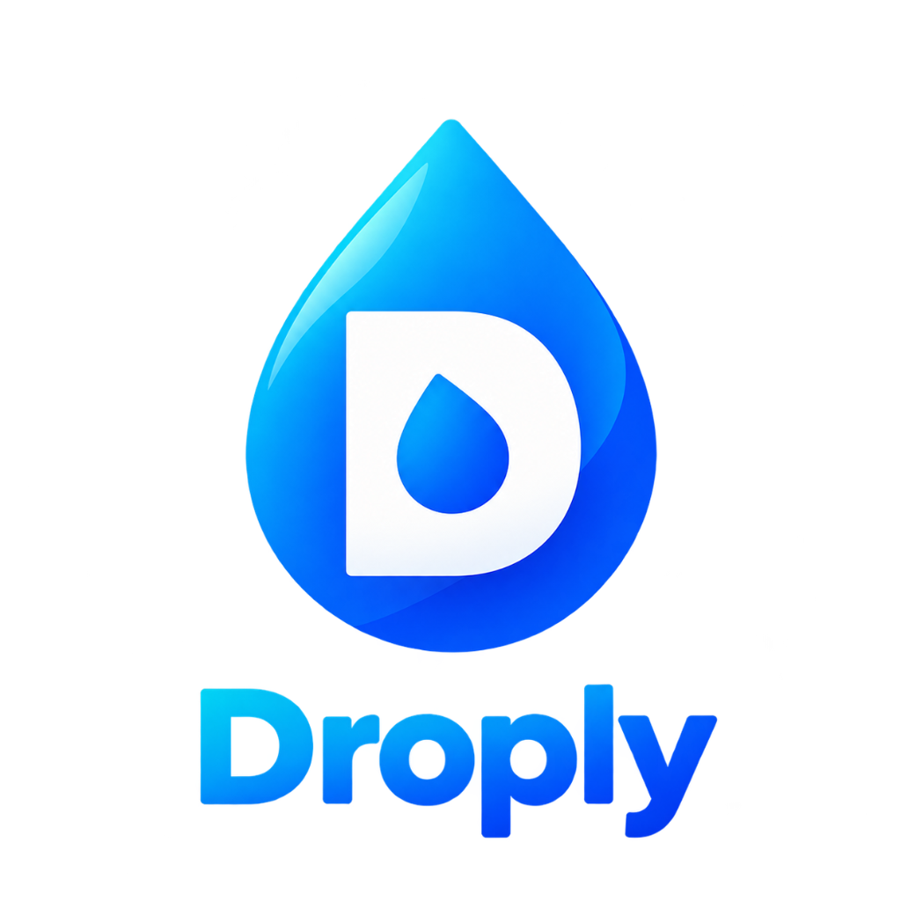
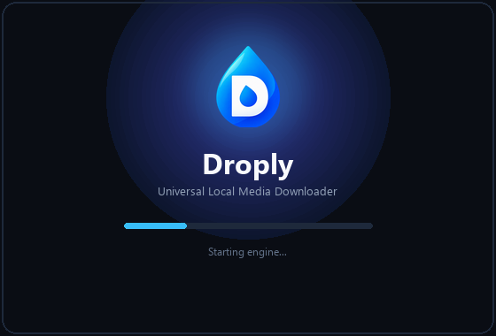

## Your media. Your quality. Your library

*A local-first video, audio, and social media downloader for Windows, with an experimental Android edition.*

*Download Videos, Reels, Shorts, playlists, albums, and audio from YouTube, Instagram, TikTok, Facebook, Reddit, X, Bilibili, and 1,000+ supported media sites at full quality — with live progress and speed tracking.*

[-0078d4.svg?style=flat-square&logo=windows)](https://github.com/Amlan-Sarkar/Droply/releases)

[**Get Droply**](#get-droply) · [**Explore Features**](#built-for-your-downloads) · [**Supported Sources**](#where-droply-works) · [**How to Use**](#using-droply)

---

## ✧ Why Droply?

Media downloads shouldn't require juggling browser tabs, managing scattered files, or guessing how long a download will take.

Droply brings media extraction, quality selection, download management, and file organization into one interface. Paste a supported link, inspect the available media, choose your preferred format, and follow the download from start to finish.

- **Choose your format:** Select available video resolutions or extract audio in supported formats.
- **Keep collections organized:** Download playlists and albums into dedicated folders.
- **Handle multiple links:** Queue multiple URLs and track their progress together.
- **See every download in motion:** Monitor progress, speed, downloaded size, and estimated time remaining.
- **Make it yours:** Customize download preferences, choose a theme, and revisit your local download history.
- **Keep control local:** Download operations run on your device without built-in analytics or third-party proxy routing.

---

## ✦ Built for your downloads

<table>
<tr>
<td width="50%" valign="top">

### 🎬 Video & Audio

Select from available resolutions, including 4K/2160p, 2K/1440p, 1080p, 720p, 480p, 360p where supported. Choose the best available format or inspect available containers and estimated file sizes.

Extract audio as MP3 at up to 320 kbps, Apple AAC in M4A, or WAV where supported.

</td>
<td width="50%" valign="top">

### 📚 Playlists & Albums

Detect supported playlist and album URLs, inspect the available item count, and organize downloads into a dedicated folder named after the playlist.

Keep related media together instead of scattering individual files across your download directory.

</td>
</tr>
<tr>
<td width="50%" valign="top">

### ⚡ Live Download Tracking

Follow downloads with a live progress bar, speed in MB/s, downloaded file size, and a dynamically updated estimated time of arrival (ETA).

A breathing local services indicator also displays real-time engine connectivity and status.

</td>
<td width="50%" valign="top">

### 📥 Batch Queue

Add multiple URLs on separate lines or separated by commas. Droply parses valid links, applies global presets, and displays queue counters with live progress feedback.

</td>
</tr>
<tr>
<td width="50%" valign="top">

### 🗂️ Local Library & History

Review past downloads, play completed files, open their containing folders, or clear your download history.

Filename sanitization preserves original media titles while removing reserved filesystem characters and helping prevent accidental file overwrites.

</td>
<td width="50%" valign="top">

### ⚡ Instant Splash & Fast Boot

Instant ~50ms visual feedback on launch with Droply's glowing cyber-cat mascot splash window (*“🐾 Waking up Droply...”*), paired with engine lazy-loading and non-blocking background prewarming so you jump straight to the download interface.

</td>
</tr>
<tr>
<td width="50%" valign="top">

### 🍪 Bot Challenge Bypass

Integrated authentication manager supports browser session extraction (Firefox, Brave, Vivaldi, Chrome, Edge) or importing Netscape `cookies.txt` to bypass YouTube *"Sign in to confirm you're not a bot"* challenges.

</td>
<td width="50%" valign="top">

### 🌐 Regional Network Resilience

Smart error detection identifies country-level ISP blocks and geo-restrictions, providing actionable guidance for seamless downloads with VPNs like Cloudflare WARP or ProtonVPN.

</td>
</tr>
</table>

  

### More built in

- **In-app updates:** Check for new Droply releases and view release notes directly inside the application.
- **Engine maintenance:** Update the embedded yt-dlp core engine from within the application with a single click.
- **Dynamic version synchronization:** Keeps the displayed application version synchronized with release tags.
- **Flexible download settings:** Customize default download directory, quality presets, and concurrent-connection preferences.
- **Local-first execution:** No built-in telemetry, analytics, or external tracking.

---

## ⬇️ Get Droply

Droply provides pre-compiled packages for Windows and Android. Development tools and a separate Python installation are not required for the packaged releases.

### 🪟 Windows — Stable

*The primary Droply experience, powered by the full Windows download engine.*

| Package | Format | Download (v1.3.9) | Latest Mirror |
| :--- | :--- | :--- | :--- |
| **Droply Setup** *(Recommended)* | `.exe` Modern Installer | [**Download v1.3.9**](https://github.com/Amlan-Sarkar/Droply/releases/download/v1.3.9/Droply-Setup.exe) | [Latest Installer Mirror](https://github.com/Amlan-Sarkar/Droply/releases/latest/download/Droply-Setup.exe) |
| **Droply Portable** | Standalone `.zip` | [**Download v1.3.9**](https://github.com/Amlan-Sarkar/Droply/releases/download/v1.3.9/Droply-Windows-x64.zip) | [Latest ZIP Mirror](https://github.com/Amlan-Sarkar/Droply/releases/latest/download/Droply-Windows-x64.zip) |

#### Install or launch

- **A. Setup Installer:**
  1. Download **`Droply-Setup.exe`**.
  2. Run the installer and follow the prompts. Droply installs into your user profile without requiring administrator prompts.
  3. Launch from the Start Menu, Windows Search, or desktop shortcut. Supports clean, seamless updates.
- **B. Portable Archive:**
  1. Download **`Droply-Windows-x64.zip`**.
  2. Extract the archive to your preferred folder.
  3. Run **`Droply.exe`**. No installation required—runs from any folder or USB drive.

#### Windows compatibility

| Requirement | Details |
| :--- | :--- |
| **Operating system** | Windows 10, version 1809 or later, or Windows 11 |
| **Architecture** | x86_64 |
| **Interface dependency** | Microsoft Edge WebView2 *(with automatic browser fallback)* |
| **Framework** | .NET Framework 4.5+ |
| **Media engine** | yt-dlp with bundled FFmpeg |
| **Media capabilities** | High-resolution stream merging, audio conversion, playlist folders |
| **Desktop integration** | Native taskbar integration & badges |
| **Testing note** | Tested on Windows 11 |

[Browse all Windows releases →](https://github.com/Amlan-Sarkar/Droply/releases)

---

### 🤖 Android — Experimental

*An early mobile build for community testing and feedback. Android support is still being validated, particularly around storage locations, folder navigation, and batch queue behavior.*

| Package | Supported Architectures | Direct Package | Releases |
| :--- | :--- | :--- | :--- |
| **Droply for Android** | `arm64-v8a`, `armeabi-v7a`, `x86_64` | [**Download APK**](https://github.com/Amlan-Sarkar/Droply/releases/download/v1.3.6/Droply-Android.apk) | [All Releases](https://github.com/Amlan-Sarkar/Droply/releases) |

#### Installation

1. Download **`Droply-Android.apk`** to your device.
2. Open the APK file. If prompted, allow installation using Android's *"Install unknown apps"* permission.
3. Launch Droply from your app drawer.
4. To send a media link to Droply, use the Android **Share** menu from a supported browser or social media app.

#### Android compatibility

| Requirement | Details |
| :--- | :--- |
| **Minimum operating system** | Android 7.0 Nougat, API 24+ |
| **Architectures** | `arm64-v8a`, `armeabi-v7a`, `x86_64` |
| **Interface dependency** | Android System WebView |
| **Media engine** | Embedded Python 3.11 with yt-dlp |
| **Current capabilities** | Best available progressive streams (up to 720p HD) and audio |
| **Status** | Experimental; under validation |

> [!WARNING]
> **Android is not yet a fully validated release.**
> Core download operations, folder navigation, batch queue behavior, and file-storage locations are undergoing active debugging and validation. Occasional instability is possible while mobile engine issues are being addressed.
> Downloaded files may be located through your device's media player or in the public `Download/Droply` directory.

---

## 🌐 Where Droply works

Droply uses yt-dlp to extract supported media across 1,000+ sites. Actual compatibility, available streams, and maximum quality depend on the source website and individual media link.

| Source | Supported media | Quality and behavior |
| :--- | :--- | :--- |
| **YouTube** | Videos, Shorts, music, playlists | Up to 4K UHD 60fps on Windows, with automatic high-bitrate video/audio stream merging |
| **Instagram** | Reels, Stories, posts, carousels | MP4 video clips and high-resolution images where available |
| **TikTok** | Video posts and audio clips | High-definition video streams without platform watermarks where supported |
| **X / Twitter** | Video tweets, clips, GIF loops | Best available progressive MP4 bitrate streams |
| **Facebook** | Public watch videos and Reels | High-definition and standard MP4 streams |
| **Reddit** | Hosted videos (`v.redd.it`) | Automatic video and audio track merging |
| **Bilibili** | Videos and animation clips | High-resolution streaming media |
| **Vimeo** | Showcase and portfolio videos | Adaptive MP4 streams |
| **SoundCloud** | Audio tracks and full albums | High-quality audio extraction |
| **Direct links** | `.mp4`, `.webm`, `.mp3`, `.wav` | Accelerated streaming chunk downloads |

---

## 🎯 Using Droply

### A. Download a single video or audio track

1. **Copy a link:** Copy a video, Reel, post, or audio URL from a browser or mobile app.
2. **Paste it:** Paste the URL into the input field, or click **Paste**.
3. **Analyze it:** Click **Analyze** (or press **Enter**) to preview title, uploader, thumbnail, and duration.
4. **Choose a format:**
   - **Video Mode:** Choose *Best Available*, *4K/2160p*, *2K/1440p*, *1080p*, *720p*, or another available resolution.
   - **Audio Mode:** Select *MP3 (320 kbps HQ)*, *M4A*, or *WAV*.
5. **Start the download:** Click **Download Media** and follow live progress, speed, downloaded size, and ETA.
6. **Open the result:** Click **Play File** to play immediately, or **Open Containing Folder** to reveal the file.

### B. Download playlists and albums

1. Paste a supported YouTube playlist, album, or series URL into the input field.
2. Droply detects the playlist and displays its item count.
3. Start the download: Droply automatically creates a dedicated subfolder named after the playlist inside your selected download directory.

### C. Queue multiple links

1. Open the **Batch Downloader** tab.
2. Paste multiple URLs (one per line or separated by commas).
3. Click **Add URLs to Queue**. Droply parses valid URLs, queues them, and processes downloads with live progress.
4. Click **Clear Completed** when you want to remove finished tasks and refresh the queue counter.

### D. Browse your download history

- Open **Library & History** to review previous downloads.
- Open files directly, reveal their exact folder location, or clear download history with one click.

### E. Customize your experience

- Open **Settings** to choose between 3 curated themes:
  - 🌌 **Neon Midnight** (Default dark palette with indigo and violet accents)
  - 🖤 **OLED Pure Black** (Pure black designed for AMOLED displays)
  - ⚡ **Cyberpunk Cyan** (High-energy cyan and neon accents)
- Customize default download directory, quality presets, and concurrent connections.
- Click **Save Preferences** to apply your changes.

### F. Check for updates

- Click **Check for Updates** in the application header or Settings.
- View the latest Droply release information or update the embedded yt-dlp core engine with a single click.

---

## 🍪 Bypassing YouTube "Sign In to Confirm You're Not a Bot"

YouTube occasionally challenges anonymous requests from downloaders with bot-verification checks (`Sign in to confirm you're not a bot`). Droply provides two built-in solutions:

### Option 1 (Easiest) — Local Browser Session Extraction
1. Open **Settings** in Droply.
2. Under **Browser Session Extraction**, select **Auto-Probe Installed Browsers** or choose your installed browser (e.g., **Firefox**, **Brave**, **Vivaldi**, **Edge**, or **Chrome**).
3. Droply will automatically use your existing browser session to authenticate requests.

### Option 2 (Persistent & Portable) — cookies.txt Import
1. In your browser (Chrome, Edge, or Firefox), install the extension **Get cookies.txt LOCALLY**.
2. Log into YouTube, click the extension icon, and export your cookies as `cookies.txt`.
3. In Droply **Settings**, click **Browse...** or **Upload...** under **Persistent cookies.txt File** and select your file.
4. Your cookies are saved securely on your PC in `~/.droply/cookies.txt` (or `%LOCALAPPDATA%\Droply\cookies.txt`) and never transmitted anywhere else.

---

## 🌐 Regional Bans & VPN Advisory

> [!WARNING]
> **Platform Bans (e.g., TikTok in India, regional geo-blocks):**  
> If an online platform is banned or restricted by your country's government or Internet Service Providers (ISPs), connection attempts will silently time out (*"Connection timed out or was blocked by host/ISP"*).

To download media from banned or region-locked platforms:
- **Turn on a VPN** connected to an unrestricted region (e.g. **Cloudflare WARP**, **ProtonVPN**, or **Windscribe**).
- Or configure a system HTTP/SOCKS5 proxy before launching Droply. Droply will immediately route traffic through the active connection.

---

## ⚙️ Under the hood

Droply combines a local interface with its media extraction engine and supporting tools:

| Component | Role |
| :--- | :--- |
| **yt-dlp** | Media metadata extraction, format discovery, and downloading |
| **FFmpeg** | Video/audio stream merging and audio conversion on Windows |
| **Embedded Python 3.11** | Part of the experimental Android media engine |
| **Microsoft Edge WebView2** | Windows interface dependency, with browser fallback when unavailable |
| **Android System WebView** | Android interface dependency |

---

## ⚖️ Privacy & responsible use

Droply is an open-source utility designed for personal archival, educational, and authorized fair-use purposes.

### 🛡️ Security & Privacy Architecture

- **Localhost-Only Binding:** Backend server strictly binds to `127.0.0.1`, ignoring external network interfaces.
- **Dynamic Authentication Token:** All `/api/*` and WebSocket endpoints require a cryptographic `X-Auth-Token` generated at startup to prevent unauthorized local script or browser tab access.
- **Cross-Site Attack Protection:** Requests with external `Origin` headers or `Sec-Fetch-Site: cross-site` are blocked with `403 Forbidden`.
- **Command Injection Prevention:** File launch and directory inspection calls use `os.startfile()` and token-safe `explorer.exe` process arguments without shell expansion (`shell=False`).
- **Path Traversal Guards:** Strict containment checks ensure all disk operations and file retrieval requests are confined within user-authorized directories.
- **Input Bounding:** Hard limits on URL lengths (2048 chars), directory paths (1000 chars), and playlist items (500 items ceiling) protect system memory against denial-of-service abuse.
- **Zero Telemetry:** No third-party analytics, ads, or external cloud telemetry requests.

### Copyright and platform terms

Users are solely responsible for complying with applicable copyright laws and website Terms of Service. Droply does not bypass DRM (Digital Rights Management), decrypt subscription-protected streams, or circumvent private authentication walls. Only download media you own or are authorized to access and save.

---

## 💬 Feedback & community

- 🐛 **Issues & feature requests:** [Open an issue on GitHub](https://github.com/Amlan-Sarkar/Droply/issues)
- 🚀 **Releases & updates:** [Browse all Droply releases](https://github.com/Amlan-Sarkar/Droply/releases)
- 📂 **Source code:** [Explore the Droply repository](https://github.com/Amlan-Sarkar/Droply)

---

## 📄 License

Droply is distributed under the [MIT License](LICENSE).

 

Made with care, a little curiosity, and a sleeping cat. 🐈  
**Yours Truly, Droply**

